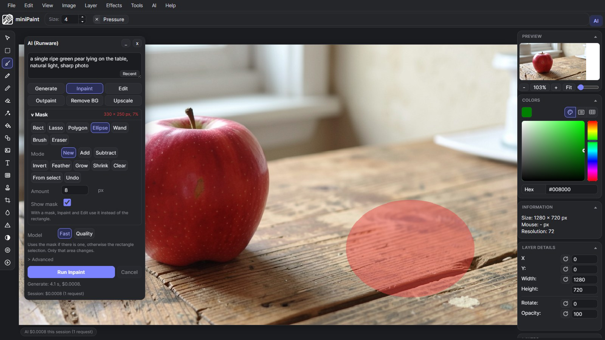
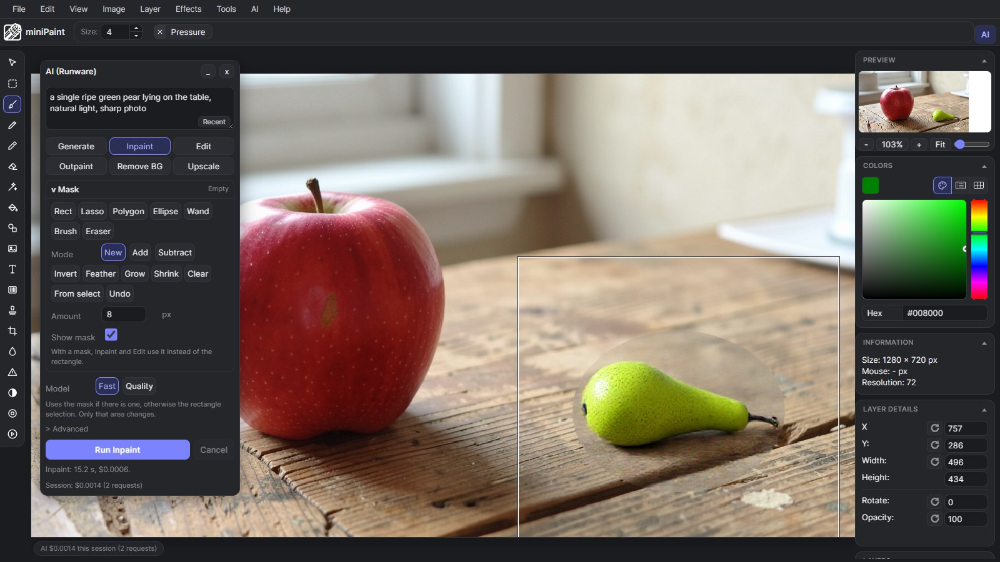
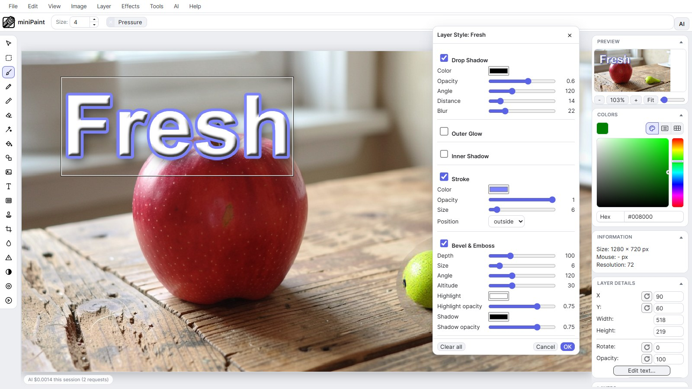

# miniPaint

Online image editor lets you create and edit images using HTML5 technologies. No need to buy, download, install, or have outdated flash. No ads. Key features: layers, filters, open source Photoshop alternative.

miniPaint operates directly in the browser. You can create images by pasting from the clipboard (ctrl+v) or uploading from the computer (_using menu or drag & drop_). Nothing will be sent to any server. Everything stays in your browser. 

## URL:
**https://viliusle.github.io/miniPaint/**

## Preview:

(generated using miniPaint)

**Change log:** [/miniPaint/releases](https://github.com/viliusle/miniPaint/releases)

## Browser Support
- Chrome
- Firefox
- Opera
- Edge
- Safari
- Yandex

## Features

**Files**: open images, directories, URLs, data URLs, drag and drop, save (PNG, JPG, BMP, WEBP, animated GIF, TIFF, JSON (layers data), print.

**Edit**: undo, cut, copy, paste, selection, paste from the clipboard.

**Image**: information, EXIF, trim, zoom, resize (Hermite resample, default resize), rotate, flip, color corrections (brightness, contrast, hue, saturation, luminance), automatic color adjustment, grid, histogram, negative.

**Layers**: multi-layer system, differences, merging, flattening, transparency support.

**Effects**: black and white, blur (box, gaussian, stack, zoom), bulge/pinch, denoise, desaturation, dither, dot screen, edge, emboss, enrich, gamma, grains, grayscale, heatmap, jpg compression, mosaic, oil, sepia, sharpen, solarize, tilt shift, vignette, vibrance, vintage, blueprint, night vision, pencil, also instagram filters: 1977, aden, clarendon, gingham, inkwell, lo-fi, toaster, valencia, x-pro ii.

**Tools**: pencil, brush, magic wand, eraser, fill, color picker, letter, crop, blur, sharpener, desaturation, clone, borders, sprites, keypoints, color zoom, change color, restore transparency, content fill. 

**Help**: keyboard shortcuts, translation.

## Embed
To embed this app on another page, use the following HTML code:

    <iframe style="box-sizing:border-box; width:100%; height:100vh;" id="miniPaint" src="https://viliusle.github.io/miniPaint/" allow="accelerometer; autoplay; clipboard-write; encrypted-media; gyroscope; picture-in-picture; web-share" allowfullscreen></iframe>

## Build instructions
See [Wiki > Build instructions](https://github.com/viliusle/miniPaint/wiki/Build-instructions)

## Try it
- **Online demo (editor only, no AI):** https://tanvirhafiz.github.io/miniPaint/ . Layers, layer effects, mask tools and the light and dark themes work. The AI buttons are off because there is no server to hold an API key.
- **Portable download (with AI):** get `miniPaint-AI-<version>-portable.zip` from the [latest release](https://github.com/TanvirHafiz/miniPaint/releases/latest), unzip, and run `start.bat` (Windows) or `./start.sh` (Mac and Linux). Needs [Node.js](https://nodejs.org) 18 or newer and your own [Runware](https://runware.ai) API key, which you paste into `server/.env` on first start. Run `start.bat --mock` to try the AI with fake, free results.

**For maintainers**
- Release: `git tag v0.1.0 && git push origin v0.1.0`. The *Release portable zip* workflow tests, builds `miniPaint-AI-v0.1.0-portable.zip` and attaches it to a new GitHub release.
- Demo: every push to `master` redeploys the static demo through the *Deploy demo to GitHub Pages* workflow (repository Settings > Pages > Source: GitHub Actions).
- Build the zip locally: `npm run package` (output in `release/`, never contains `server/.env`). Serve the built app plus proxy without webpack: `node server/serve.js`.

## Screenshots
A free-form mask (Ellipse tool, red overlay) marks where an AI edit may happen:



Inpaint with the prompt "a single ripe green pear lying on the table": only the masked area changes, the result is a new layer, the cost is shown, and one Ctrl+Z removes it:



Non-destructive layer effects (drop shadow, stroke and bevel on a text layer) in the Layer Style dialog, light theme:



The pictures were made with the app itself against the real Runware API (Generate for the apple, Inpaint for the pear, about $0.003 in total).

## AI features (Runware)
This fork adds AI image generation through the [Runware](https://runware.ai) API. The browser never sees the API key: a small local proxy in `server/` adds it to each request.

**1. Provide the key** (one of):
- GitHub Codespaces: add a Codespaces secret named `RUNWARE_API_KEY` (GitHub > Settings > Codespaces > Secrets, allow this repository), then rebuild or restart the Codespace.
- Local: `cp server/.env.example server/.env` and set `RUNWARE_API_KEY=...` (the file is gitignored). An environment variable wins over the file.

**2. Run**
```
npm install
npm run start:ai        # proxy (port 8787) + dev server (port 8080) together
# or in two terminals:
npm run proxy
npx webpack serve --mode development --env development --no-open
```
Open http://localhost:8080 (in Codespaces, open the forwarded port 8080). The dev server forwards `/api/*` to the proxy.

**3. Use the AI panel.** It floats over the canvas (drag it by its title, collapse with `_`, hide with `x`; the **AI** button in the top bar or *AI > Show / Hide AI Panel* brings it back). Type a prompt, pick a verb tab, press **Run** (or Ctrl+Enter). Mark the area first when a verb works on a region: draw a rectangle with the Select tool, or use the **Mask** section (see below).
- **Generate**: new image from the prompt at canvas size, as a new layer.
- **Inpaint**: repaints only the mask or rectangle selection from the prompt (FLUX Fill). Needs a mask or selection.
- **Edit**: instruction edit ("make the jacket red"). With a mask or selection only that area changes, otherwise the whole image.
- **Outpaint**: extends the canvas on the chosen sides by N px and fills the new border. Prompt optional.
- **Remove BG**: cut-out of the active layer (or the whole image) as a new transparent layer; "Hide original" is one click.
- **Upscale**: 2x or 4x of the whole image. The canvas and every layer scale up and the upscaled image is added on top (one undo); "Download PNG" is offered too.
- **Fast / Quality** picks the preset model; **Advanced** has the model list, strength (Inpaint), 1 to 4 variations (pick one from the thumbnails or Place all) and the edge feather.

Every result is a new layer named `AI <verb>: <prompt>` and one Ctrl+Z removes it. The status line shows time and cost, plus a session total. **Cancel** (or Escape in the panel) stops a running request.

**With a real key, run *AI > Diagnose Request Format* once.** It sends two tiny background-removal requests (about $0.0006 each), finds which Runware request format your account accepts and remembers it in the browser. The client also falls back automatically, but diagnosing first avoids a failed first request. *AI > Runware Settings / Test Connection* checks the proxy and the key and can reset the remembered format.

**Mock mode** (no key, no network): `npm run proxy:mock` or `npm run start:ai -- --mock` returns plausible fake results for every verb (color-shifted region for inpaint and edit, transparent border for Remove BG, scaled image for Upscale) with cost 0. `RUNWARE_MOCK_DELAY_MS=3000` adds latency to try Cancel; `RUNWARE_MOCK_REJECT_STYLE=inputs` makes the mock reject one request format so the fallback can be seen.

**Debug**: *AI > Debug: Export Region + Mask* adds the crop and mask that an inpaint request would send as layers (and offers the PNGs); *AI > Debug: Place Test Result* inverts the region locally and places it back like an AI result. Both use the current rectangle selection, or the whole canvas.

**Mask tools** (AI panel > Mask). Free-form areas for Inpaint and Edit, shown as a red overlay. Tools: Rect, Lasso, Polygon (click points, Enter or double-click to close, Esc cancels), Ellipse, Wand (tolerance, contiguous), Brush and Eraser (`[` and `]` change the size). Modes: New, Add, Subtract (Shift adds, Alt subtracts). Actions: Invert, Feather, Grow, Shrink (by the Amount in px), Clear, From select, Undo. When a mask exists Inpaint and Edit use it instead of the rectangle, and the result layer is clipped to it. Ctrl+Z undoes the mask while a mask tool is active. The mask clears when the document size changes.

**Layer effects.** Layer > Layer Style... (or the **fx** button on a layer row) opens a live preview dialog with Drop Shadow, Outer Glow, Inner Shadow, Stroke (outside, inside, center) and Bevel & Emboss. Effects are non-destructive, saved in the JSON project file, and one Ctrl+Z undoes a dialog edit. Layer > Copy / Paste / Clear Layer Style move a style between layers.

**Themes.** The default look is the Studio theme in dark and light. *View > Toggle Light / Dark Theme* switches and remembers the choice; the older green theme is still in Tools > Settings.

**Shortcuts**
| Keys | Action |
| --- | --- |
| Ctrl+Enter | Run the current AI verb (works anywhere, and inside the panel) |
| Ctrl+Shift+E | Switch to Edit and focus the prompt box |
| Alt+Up / Alt+Down in the prompt box | Step through recent prompts (also the **Recent** button) |
| Esc in the panel | Cancel a running request |
| `[` and `]` with Brush or Eraser | Brush size |

The last 30 prompts are remembered in the browser. A small chip in the bottom left of the editor shows the AI cost for this session and a working indicator; click it to show the panel.

**Tests**: `npm run test:ai` (size and region math, client fallback, layer effects math, mask math, prompt history; `node --test`).

Project plan: `plan.md`. Code map: `docs/ARCHITECTURE-NOTES.md`.

## Wiki
See [Wiki](https://github.com/viliusle/miniPaint/wiki)

## Contributors
<a align="center" href="https://github.com/viliusle/miniPaint/graphs/contributors">
  
</a>

## License
MIT License

## Support
Please use the GitHub issues for support, feature requests and bug reports, or contact us by sending an email to www.viliusl@gmail.com.
